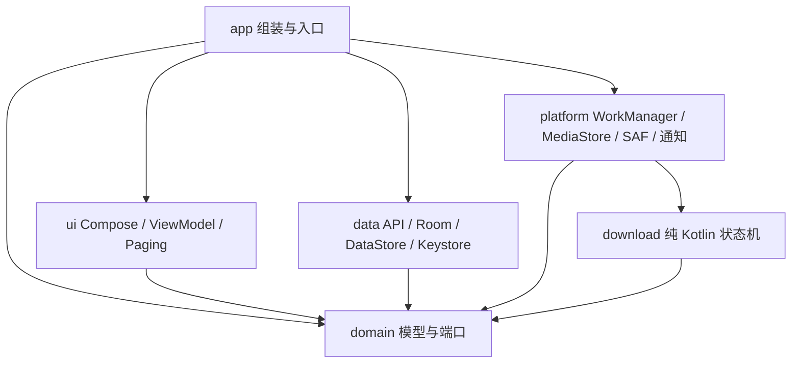
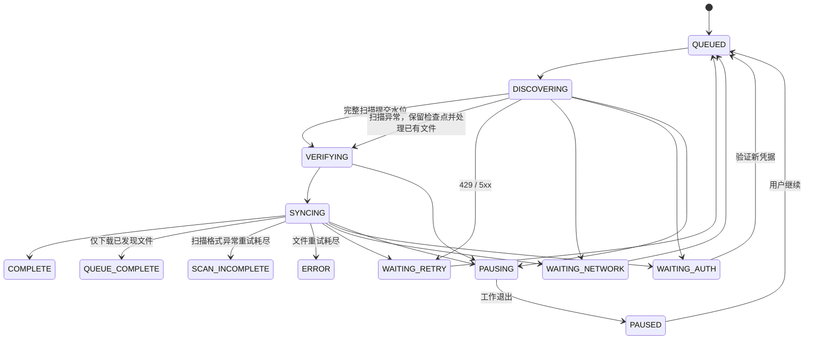

# 2.0 模块化重构

方案 B 使用六模块单进程应用。模块划分围绕依赖方向、持久化边界和平台副作用，后续功能仍可在当前 UI 模块按功能分包；不提前为每个页面建立 Gradle 模块。

## 职责与扩展点

- `AppGraph` 是唯一组装入口。UI 接收 `AppServices`，ViewModel 不持有 Context 或具体 Repository。文件与后台任务操作留在平台适配器。
- `CatalogGateway` 返回已验证的帖子与标签，抛出领域错误。API 解析、账号校验和限速在 data，不进入下载状态机。
- `SyncRepository` 定义页面、检查点、状态和已发布文件的持久化操作。Room 是实现，JVM 测试可替换成行为性 fake。
- `MediaTransport` 打开媒体流；`MediaDownloader` 负责文件校验与发布；`FileReuse` 查找并校验已有 URI、当前目录和 SAF 文件。引擎无需知道 OkHttp 或 MediaStore。
- `TaskController` 负责手动/批量操作及调度；Worker 只把 Android 工作生命周期映射到引擎与通知。
- 订阅、添加订阅、图库、任务和设置各自持有 ViewModel。图库使用 Room 查询与 Paging，限制内存中的页面数。

替换元数据来源只需实现 `CatalogGateway`。增加导出存储只需实现 `MediaDownloader` / `FileReuse` / 目录选择端口。增加任务优先级可在调度器与持久化任务模型扩展。当前 ID 和文件目录仍按 Rule34 单站设计；多站点上线前需要为帖子、订阅和文件标识增加 source ID，避免不同站点的数字 ID 相撞。

## 数据模型

| 表 | 内容 |
| --- | --- |
| `collections` | 订阅、旧 Pool、用户暂停意图、持久化任务模式、已完成扫描水位、当前运行 lease、状态与退避 |
| `posts` | 按 Post ID 去重的元数据 |
| `collection_posts` | 订阅与帖子的多对多关联；旧 Pool 保存 position |
| `download_tasks` | 每个目录下帖子的传输状态、字节进度、失败次数 |
| `local_files` | 每个关联的已保存 URI、长度和已验证 MD5 |
| `sync_checkpoints` | 未完成扫描的下界、下一页上界和当前最高 ID |

一个帖子可属于多个订阅并在多个目录保存，文件记录保留各自 URI。全局图库按 Post ID 去重；单订阅图库保留目录关联，旧 Pool 使用 position 顺序。删除订阅由外键级联删除关联，不删除实际文件。

## 状态与一致性

状态、任务队列、扫描水位和任务模式分别持久化。`user_paused` 与 `sync_mode` 是用户意图；网络错误、暂停和重启不会清除它们。已发现文件可在 API 无凭据时独立下载，认证变更只暂停需要 API 的任务。旧 Pool 的 `ARCHIVED` 状态不启动网络任务。

扫描以 `sort:id:desc` 与单个 ID 上界分页。每页严格校验 ID 顺序、边界和字段完整性，元数据、任务和检查点在同一事务保存。失败保留已保存页面，从检查点继续；完整扫描结束才更新最高 ID。元数据已完整发现后，单个媒体下载失败不会回滚扫描水位。

原站 DAPI 的无结果 JSON 搜索返回 HTTP 200、零字节正文。客户端保留相同查询参数和认证，以 XML 再请求一次；只有完整解析的 `<posts count="0">` 才确认空页。具有有效 ID 但缺少原文件地址的帖子以独立失败项持久化，允许其他帖子和分页继续；无法定位身份、分页重复或无法确认完整响应时保留扫描检查点。扫描失败不阻断已发现的可信文件。帖子兼容 `md5` / `hash`，作者标签兼容数字和文本类型。按 ID 获取的响应必须匹配请求的 Post ID，避免错误原文件替换既有信息。

手动操作明确分为重试扫描、只下载已发现文件和从头扫描。只下载模式完全不调用 CatalogGateway，完成后使用 QUEUE_COMPLETE，避免把本地队列完成误报为作者全量扫描完成。模式同时持久化在 Room 与 WorkManager 输入中，延时重试、暂停继续及进程恢复均保留。完整重扫先取消旧工作并等待目录互斥锁释放，再在事务中重置扫描水位/检查点，文件 URI 和已发现关联全部保留。

每个运行使用独立 `run_id`。beginRun 仅在没有活动 lease 时原子获取，不再覆盖正在运行的任务。Room 在事务中验证 lease，已取消或替换的工作不能覆盖后继任务的状态、检查点或文件 URI。控制指令按订阅串行执行，目录互斥锁继续覆盖旧任务清理。WorkManager 保留旧 unique work 名称和输入 key，以便升级后恢复旧排队工作。

原文件传输完成后，先校验响应 MD5、长度，再读回已写入的文件校验。发布 MediaStore URI 与持久化完成记录在不可取消区间执行。中途取消只清理本次未发布的条目；若已发布文件的数据库写入失败，保留文件供后续复用。

文件 MD5/永久错误最多自动尝试三次，用户主动重试重置文件失败次数。网络、429、5xx 使用指数退避并尊重更长的 `Retry-After`，避免将短暂断网计入永久文件失败。引擎输出重试时机，WorkManager 实现延时调度。

## 认证与设置

账号状态为 LOADING / MISSING / READY / INVALID，联网入口仅在 READY 时可用。草稿验证失败不会使已有有效账号失效；旧请求的认证失败只会使相同已保存凭据失效。HTML 403 与 API 认证失败分开处理。

API 与媒体使用不同客户端。API 请求禁止重定向，避免认证查询参数被转发。媒体请求没有 API Key、浏览器 Cookie 或网页会话。UI 显示领域错误，不回显带密钥的请求 URL 或原始错误响应。

下载设置通过 DataStore 管理。凭据沿用原 AES-GCM 存储，更新密钥取消当前联网任务后重新调度；已完成文件和用户暂停意图保留。SAF 授权保留在系统，DataStore 只保存当前选择 URI。

手动关联目录时，平台读目录结构，领域 `FolderRestorePlan` 根据原订阅和文件夹名决定恢复与调度范围。识别作者子目录、应用根目录及其上层目录；原有标签通过旧目录命名匹配，缺少的作者订阅从包含 Post ID 文件的目录恢复。保存关联后在不可取消区间创建订阅并等待 WorkManager 调度持久化，已完成和错误订阅也重新校验，用户暂停的订阅跳过。缺失凭据时保留等待认证状态，验证后自动调度。设置页通过共享状态显示扫描过程、恢复数量、暂停数量和未识别目录。

## 迁移与验收

数据库文件名不变，版本 1–5 保留原有到 6 的迁移，再通过 6→7 添加默认 FULL 模式。直接从 6 升级也保留 local URI、verified MD5、同步水位、暂停意图和旧 Pool 顺序。失效本地文件的可信校验值会在删除 URI 关联前保留到帖子元数据，供缺失文件恢复使用。Room schema 导出到 `data/schemas`，不设置 destructive fallback。

测试分别检查协议、引擎、SQLite 事务和 Android 副作用。关键验收包括分页失败不能跳过帖子、取消不丢失已发布 URI、旧 lease 写入无效、暂停在重启后保留、实际卸载清空数据库与授权但保留公共文件，以及 3000 文件经 SAF 校验复用。
